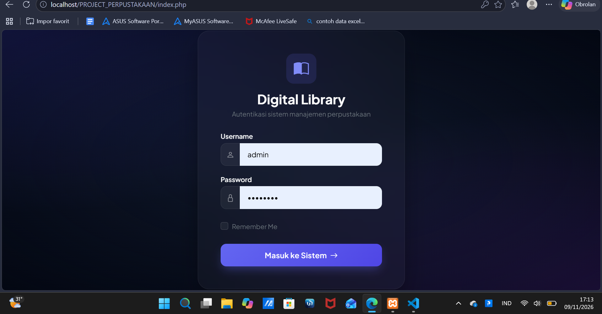
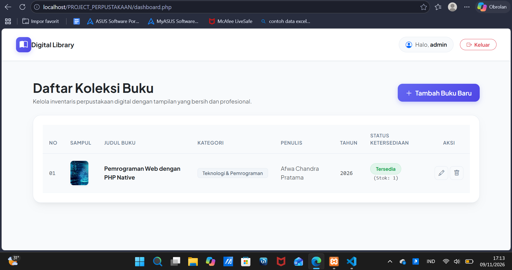
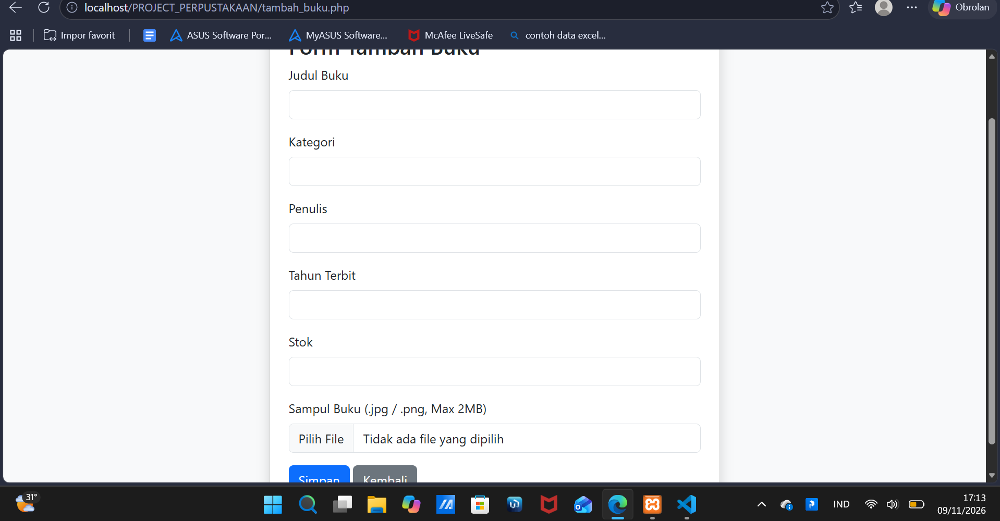
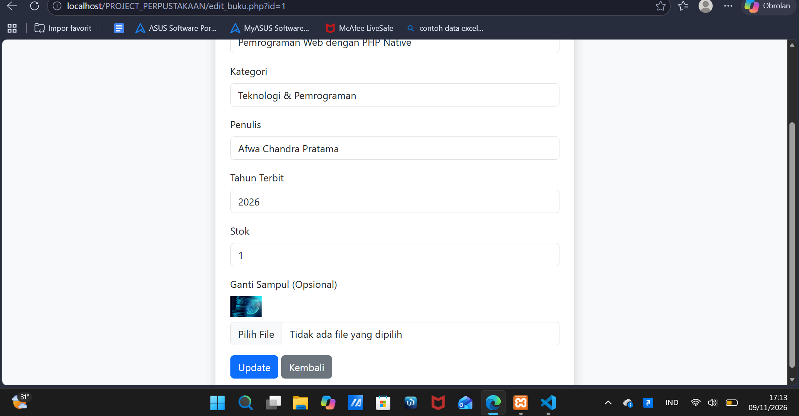

# 📚 Mini Digital Library - Sistem Informasi Perpustakaan

Aplikasi web perpustakaan digital berbasis **PHP Native** dan **MySQL** yang dikembangkan untuk memenuhi tugas mata kuliah Pemrograman Web (Program Studi Sistem Informasi).

---

## ✨ Fitur & Modul Sistem (Sesuai Ketentuan Tugas)
1. **Autentikasi & Hak Akses (Session & Cookie)**:
   * Halaman Login dengan metode POST (`index.php` & `proses_login.php`)[cite: 10].
   * Pembatasan hak akses halaman Dashboard (hanya bisa diakses jika sudah login via Session)[cite: 10].
   * Fitur Logout untuk menghapus session secara aman[cite: 10].
2. **Pengelolaan Data (CRUD Data Buku)**:
   * **Create**: Menambah data buku baru lengkap dengan upload file sampul (gambar `.jpg/.png`)[cite: 10].
   * **Read**: Menampilkan daftar koleksi buku dalam bentuk tabel HTML modern[cite: 10].
   * **Update**: Mengedit informasi data buku beserta opsi penggantian file sampul[cite: 10].
   * **Delete**: Menghapus data dari database MySQL sekaligus menghapus file gambar fisik dari folder server (`unlink`)[cite: 10].
3. **Logika Bisnis & Validasi**:
   * Penentuan label status ketersediaan otomatis berdasarkan jumlah stok (Jika > 0 "Tersedia", jika 0 "Dipinjam")[cite: 10, 11].

---

## 🛠️ Struktur Tabel Database MySQL (`db_perpustakaan`)
Berikut adalah rancangan struktur tabel utama di dalam database:

### 1. Tabel `buku`
| Nama Kolom | Tipe Data | Keterangan |
| :--- | :--- | :--- |
| `id` | INT (Primary Key) | ID Unik Buku (Auto Increment) |
| `judul_buku` | VARCHAR(255) | Judul lengkap buku |
| `kategori` | VARCHAR(100) | Kategori/genre buku |
| `penulis` | VARCHAR(100) | Nama penulis buku |
| `tahun_terbit` | INT(4) | Tahun penerbitan |
| `stok` | INT | Jumlah ketersediaan stok |
| `sampul` | VARCHAR(255) | Nama file gambar sampul di folder `uploads/` |

### 2. Tabel `user` (atau tabel admin)
| Nama Kolom | Tipe Data | Keterangan |
| :--- | :--- | :--- |
| `id` | INT (Primary Key) | ID Pengguna |
| `username` | VARCHAR(100) | Nama pengguna untuk login |
| `password` | VARCHAR(255) | Password akun (terenkripsi/plain) |

---

## 📸 Dokumentasi Tampilan (Screenshot)
*(Letakkan atau sisipkan tangkapan layar aplikasi di sini sesuai instruksi tugas)*
### **1. Halaman Login**


### **2. Halaman Dashboard CRUD**


### **3. Halaman Tambah & Edit Buku**



---

## 🎥 Link Video Demo Aplikasi
Tonton video demonstrasi penggunaan dan penjelasan program melalui tautan YouTube berikut:
👉 [https://youtu.be/Ozx9ew--j-U?si=aGlWpeY6bV3cvq7N]

---

## 🚀 Cara Instalasi & Menjalankan Project
1. Pastikan server lokal **XAMPP** (Apache & MySQL) sudah aktif[cite: 9].
2. Letakkan folder project `PROJECT_PERPUSTAKAAN` ke dalam direktori `C:\xampp\htdocs\`[cite: 9].
3. Buka **phpMyAdmin** melalui browser di alamat `http://localhost/phpmyadmin/`[cite: 9].
4. Buat database baru bernama `db_perpustakaan` dan import file database `db_perpustakaan.sql` yang ada di dalam folder project[cite: 9, 12].
5. Jalankan aplikasi melalui browser:
   ```text
   http://localhost/PROJECT_PERPUSTAKAAN/